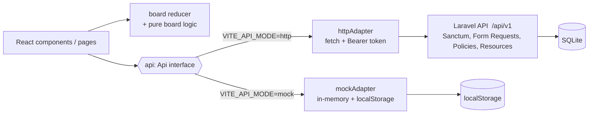

# TaskFlow

A project and task management app (Kanban boards) built as a small full stack monorepo: a **Laravel 12** JSON API and a **React 19 + TypeScript** single page app.

> **Live demo note:** the hosted demo runs the web app with the **mock adapter**: an in-browser, localStorage-backed implementation of the API contract. It does **not** talk to a Laravel server. Everything you do stays in your own browser. The Laravel API in `api/` is real and tested, but it is not deployed anywhere as part of the demo.

```
taskflow-fullstack/
  api/   Laravel 12 + Sanctum, SQLite, PHPUnit feature tests
  web/   React 19, TypeScript (strict), Vite, Tailwind CSS v4, Vitest
```

## Architecture



```
 Browser                                        Server (only in http mode)
+----------------------------------+           +-----------------------------+
| Pages / components               |           | routes/api.php  (/api/v1)   |
|   |                              |           |   auth:sanctum + throttle   |
|   v                              |   JSON    |   Form Requests (422)       |
| board reducer + applyMove()      |  Bearer   |   Policies (403)            |
|   |                              | <-------> |   Controllers -> Resources  |
|   v                              |           |   TaskOrdering (DB txn)     |
| Api interface                    |           |        |                    |
|   |-- httpAdapter --------------------------->      SQLite                 |
|   '-- mockAdapter (demo build)    |           +-----------------------------+
|        '-> localStorage          |
+----------------------------------+
```

## Stack

| Layer | Tech |
|-------|------|
| API | PHP 8.2+ (developed on 8.5), Laravel 12, Laravel Sanctum (personal access tokens), SQLite, PHPUnit |
| Web | React 19, TypeScript strict, Vite, Tailwind CSS v4 (`@tailwindcss/vite`), Vitest, Testing Library |
| CI | GitHub Actions (`.github/workflows/ci.yml`) |

## Run it

### API

```bash
cd api
composer install
cp .env.example .env          # already defaults to SQLite
php artisan key:generate
touch database/database.sqlite
php artisan migrate --seed    # demo user: demo@taskflow.test / password
php artisan serve             # http://localhost:8000
```

Requires the `pdo_sqlite` PHP extension.

### Web

```bash
cd web
npm install
cp .env.example .env.local    # VITE_API_MODE=http, VITE_API_URL=http://localhost:8000/api/v1
npm run dev                   # real API
VITE_API_MODE=mock npm run dev   # no backend needed: in-browser mock, auto-signs in the demo user
```

Build scripts:

```bash
npm run build         # type-check + production build -> dist/   (http adapter only)
npm run build:demo    # static demo -> dist-demo/, base "/demos/taskflow/", mock adapter only
```

## Tests

```bash
cd api && php artisan test     # 36 tests, 148 assertions (last run: all passing)
cd web && npm test             # 46 tests in 4 files (last run: all passing)
cd web && npm run typecheck    # tsc --noEmit
```

What is covered:

* **API (PHPUnit, in-memory SQLite):** register/login/logout/me, token revocation, auth rate limiting (429), validation 422s for every Form Request, 401/403/404 JSON error shape, ownership policies on projects and tasks (including move/delete), cascade delete, position append / gap closing, and the move endpoint (within a column, across columns, clamping, isolation between projects, rollback of the DB transaction when a write fails mid-reorder).
* **Web (Vitest + Testing Library):** one **API contract suite** (`src/api/contract.ts`) that any adapter must satisfy, run here against `mockAdapter` (auth, validation errors, ownership, reorder semantics); the `httpAdapter` is tested separately with a stubbed `fetch` (token handling, `{data}` unwrapping, error envelope mapping); pure board logic and the reducer (including optimistic move + rollback); components (badges, card keyboard controls, `<dialog>` focus and validation); and integration tests that drive the whole app on the mock adapter (keyboard move, drag and drop, create dialog, optimistic rollback on failure, empty and error states, hash deep links).

Not tested automatically: the real `httpAdapter` against a live Laravel server (the contract suite is not wired to a running API), real-browser drag and drop (jsdom has no layout, so the drop index is only unit-tested via the pure `applyMove`), and visual regressions. The GitHub Actions workflow has not been executed on GitHub.

## API (`/api/v1`)

All endpoints speak JSON. Everything except register/login needs `Authorization: Bearer <token>`.
Errors always look like `{ "message": "...", "code": "...", "errors": { field: [..] }? }`.

| Method | Path | Description | Success | Errors |
|--------|------|-------------|---------|--------|
| POST | `/auth/register` | `name, email, password, password_confirmation` -> `{ user, token }` | 201 | 422, 429 |
| POST | `/auth/login` | `email, password` -> `{ user, token }` | 200 | 401, 422, 429 |
| POST | `/auth/logout` | Revoke the current token | 204 | 401 |
| GET | `/auth/me` | Current user | 200 | 401 |
| GET | `/projects` | Your projects (with `tasks_count`) | 200 | 401 |
| POST | `/projects` | `name, description?` | 201 | 401, 422 |
| GET | `/projects/{id}` | One project | 200 | 401, 403, 404 |
| PATCH | `/projects/{id}` | Update project | 200 | 401, 403, 404, 422 |
| DELETE | `/projects/{id}` | Delete project and its tasks | 204 | 401, 403, 404 |
| GET | `/projects/{id}/tasks` | Tasks ordered by status, position | 200 | 401, 403, 404 |
| POST | `/projects/{id}/tasks` | `title, description?, status?, priority?, due_date?` (appended to its column) | 201 | 401, 403, 404, 422 |
| GET | `/tasks/{id}` | One task | 200 | 401, 403, 404 |
| PATCH | `/tasks/{id}` | Update fields; a changed `status` sends it to the end of that column | 200 | 401, 403, 404, 422 |
| DELETE | `/tasks/{id}` | Delete task, closes the position gap | 204 | 401, 403, 404 |
| POST | `/tasks/{id}/move` | `status` (todo\|doing\|done), `position` (0-based, clamped) | 200 | 401, 403, 404, 422 |

Task fields: `title` (required, max 200), `description` (max 5000), `status` todo|doing|done (default todo), `priority` low|medium|high (default medium), `due_date` `YYYY-MM-DD`, `position` (read-only integer, contiguous per project+status column).

Rate limits: `throttle:auth` 10 requests/min/IP on register and login; `throttle:api` 120/min per user on the rest.

## Design decisions

* **One typed `Api` interface, two adapters.** UI code never calls `fetch`. `VITE_API_MODE` is a build-time constant written as a direct comparison, so the bundler drops the adapter that is not selected (verified: the demo bundle contains no `Bearer`/API URL code, the http bundle contains no mock code). The mock mirrors status codes, validation rules and error shapes, and a shared contract suite keeps it honest.
* **Reorder logic is shared in spirit.** The server's `TaskOrdering` service and the client's pure `applyMove()` use the same semantics (index among the *other* tasks in the target column, clamped, both columns renumbered), so optimistic UI and the server agree. The mock adapter reuses `applyMove` directly.
* **Server-side ordering in a transaction.** A move loads the target column, splices the task in, renumbers, and renumbers the source column, all inside `DB::transaction`. Positions stay contiguous, so no gaps accumulate.
* **Optimistic updates with rollback.** Moves, creates, edits and deletes are applied to the reducer immediately; on failure the pre-action snapshot is restored and an error is shown. "Simulate network failure" in the demo banner lets you watch this.
* **Authorization via Policies**, validation via Form Requests, output via API Resources, errors normalised in `bootstrap/app.php` (including forcing JSON 401 instead of a login redirect).
* **Hash routing** (`#/projects/1`) so deep links work on a static host with no rewrite rules.
* **Accessibility:** native `<dialog>` modal (focus trap, Esc, focus returns to opener), every drag-and-drop action has labelled keyboard buttons, moves are announced through a polite live region and focus follows the moved card, priority and due state are text not just colour, `prefers-reduced-motion` respected.
* **Strict-CSP friendly demo:** no inline scripts, no CDN, no web fonts (system font stack), no runtime network calls. Checked in headless Chrome served with `default-src 'self'; img-src 'self' data:; style-src 'self' 'unsafe-inline'; script-src 'self'`: the app rendered with no CSP violations reported on the console.

## Trade-offs and known limitations

* Token auth only (Sanctum personal access tokens in `localStorage`). That is simple and works cross-origin, but is exposed to XSS; a production app might prefer httpOnly cookie SPA auth. Tokens do not expire by default here.
* Rollback restores a snapshot taken before each action. If several mutations are in flight and an earlier one fails, restoring its snapshot can also undo later successful optimistic changes until the next reload. A per-mutation queue or refetch-on-failure would fix this.
* Edits and creates close the dialog immediately (optimistic), so server-side field errors are surfaced as a banner on the board rather than next to the field. Client validation mirrors the main server rules.
* Reordering renumbers a whole column with one UPDATE per row. Fine for boards of tens or hundreds of tasks, not for huge ones (fractional/lexorank positions would scale better).
* Tasks have no assignees, comments, labels, pagination or real-time sync; projects belong to exactly one user.
* The mock adapter stores passwords in plain text in localStorage: it is a demo backend, never use it for real data. Seed due dates are relative to the first load, so they go stale; use "Reset demo data".
* Auth rate limiting is keyed by IP only.
* The demo build bundle is ~79 kB gzipped JS; there is no code splitting.
* Local development note: the API needs PHP's `pdo_sqlite` extension. On the machine this was built on it was not installed system-wide, so the extension was loaded from the official package for the PHP 8.5 build via `PHP_INI_SCAN_DIR`; CI installs it via `setup-php`.
